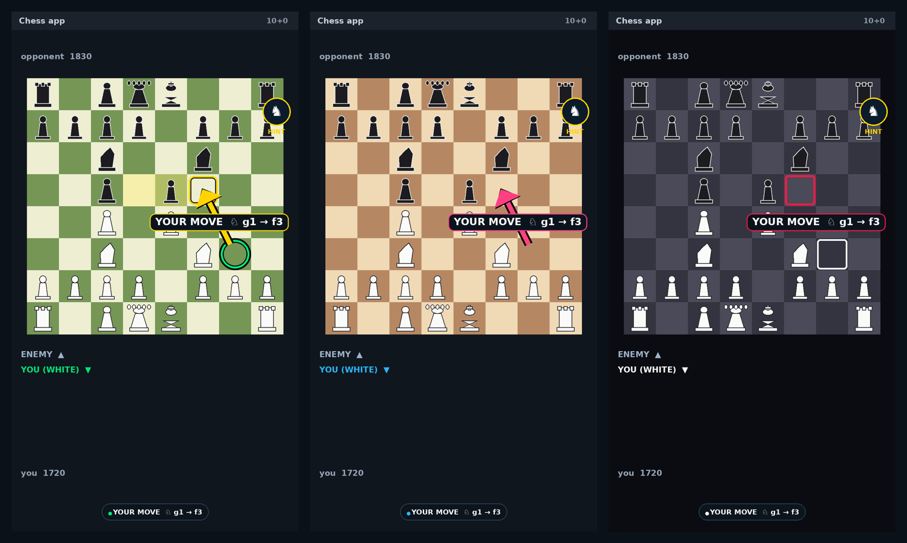
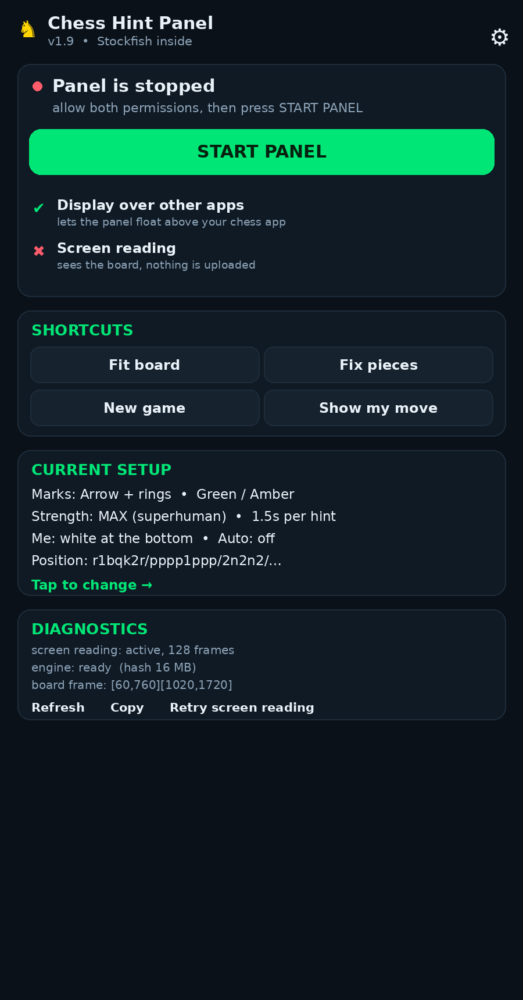
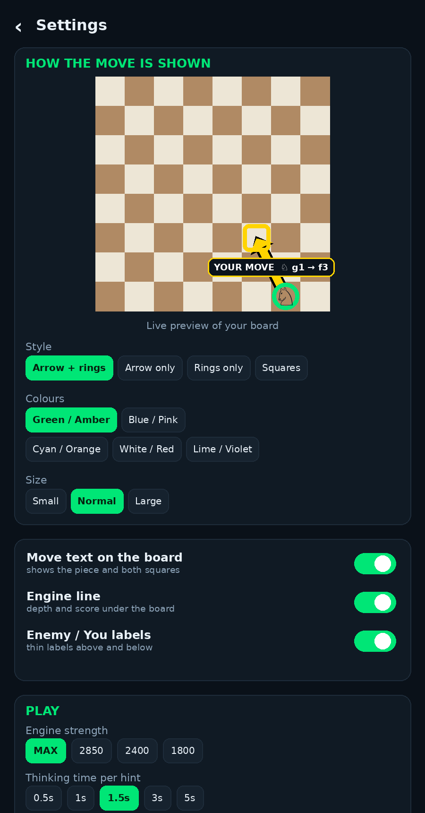
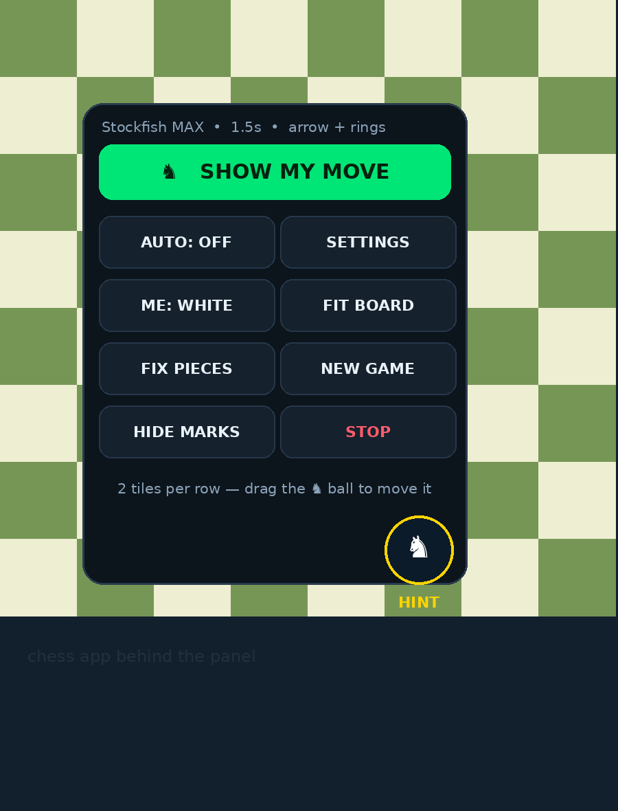
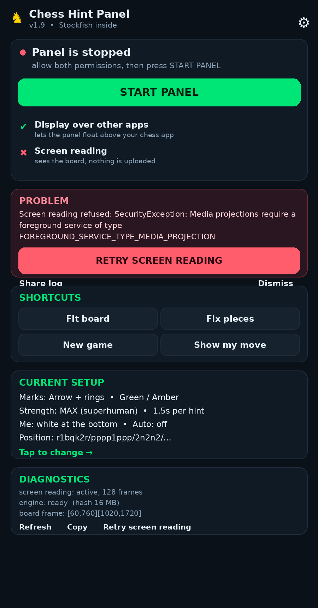
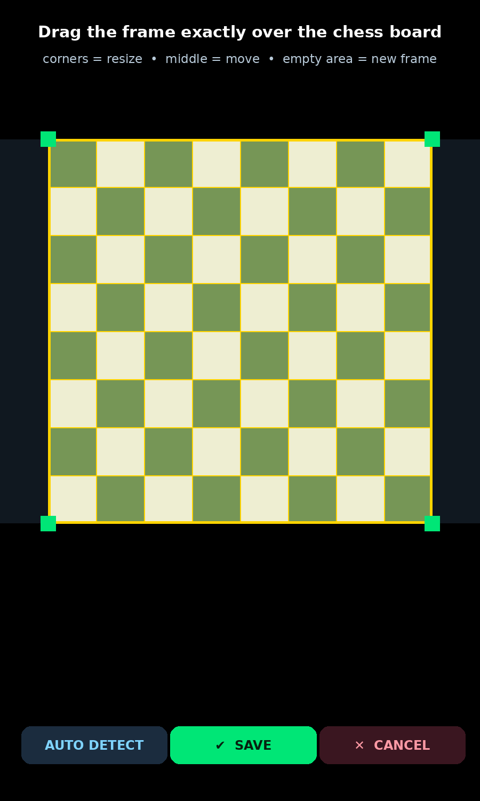
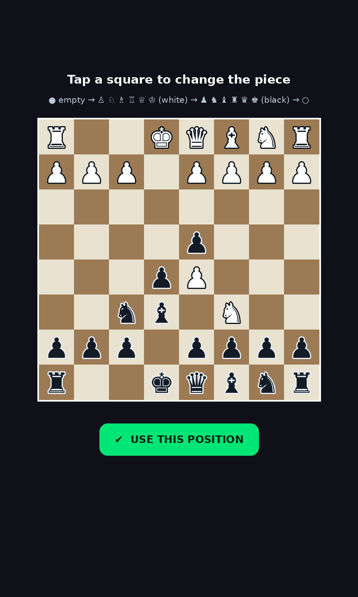
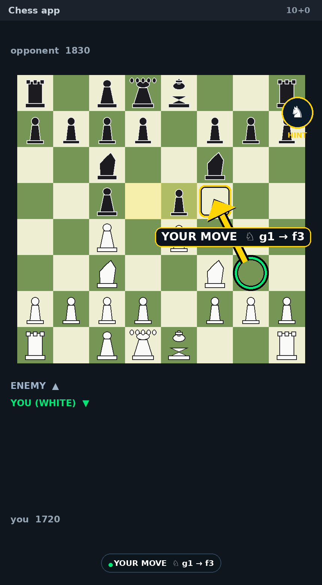
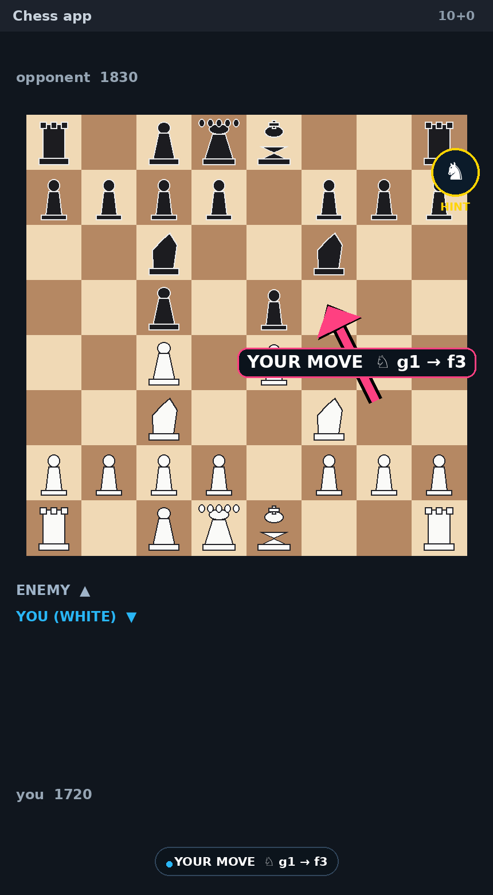
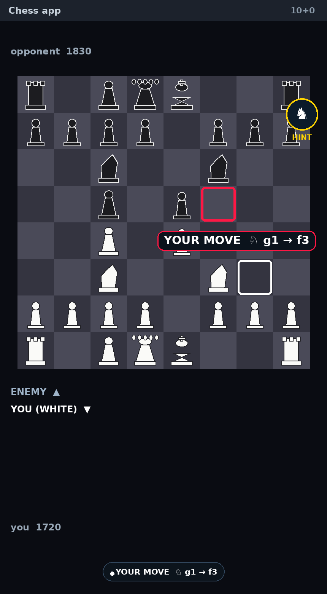

<div align="center">



# ♞ Chess Hint Panel

**A floating chess coach for Android.**
This repaired source targets official **Stockfish 19** and improves board-state trust/reconciliation. A compiled v2.3 APK was **not produced in the repair environment** because Android SDK/NDK tools were unavailable and the engine source/NNUE download was blocked. Build and test from source using [`docs/BUILDING.md`](docs/BUILDING.md) before installing. No root or paid analysis API is required; analysis is offline after a successful build.

[](../../actions/workflows/build.yml)
[](../../releases/latest)
[](../../releases)


%20%2B%20GPLv3%20(engine)-yellow)

### [🔧 **Build the repaired APK**](docs/BUILDING.md) &nbsp;·&nbsp; [📥 Install guide](docs/INSTALL.md) &nbsp;·&nbsp; [🎛 Settings](docs/SETTINGS.md) &nbsp;·&nbsp; [🔧 Build](docs/BUILDING.md) &nbsp;·&nbsp; [❓ FAQ](docs/FAQ.md) &nbsp;·&nbsp; [🔒 Privacy](docs/PRIVACY.md)

</div>

---

## 📱 The app

| Home | Settings — live preview | Floating panel |
|:---:|:---:|:---:|
|  |  |  |
| Two permissions, one button, diagnostics with a shareable log | Pick the mark style, colours and size — the preview shows exactly what your board will look like | Tap the floating ♞ anywhere, drag it around, tiles for every action |

| Screen-capture troubleshooting | Fitting the board | Fixing the pieces |
|:---:|:---:|:---:|
|  |  |  |
| Reports capture issues, offers **Retry screen reading** and a **Share log** button | Drag the frame exactly over the board — corners to resize, middle to move | Joined a game mid-way? Confirm the exact position in the existing editor or use FEN |

## ✨ Features

| | |
|---|---|
| 🎯 **Tells you the move** | Green ring on the piece, amber ring on the target square, a fat arrow between them and a badge like `YOUR MOVE ♘ g1 → f3`. |
| 🧠 **Real engine** | Stockfish 19 is the pinned build target and is bundled into the APK after a successful native build for arm64 / armv7 / x86_64 — analysis is **fully offline after installation**. |
| 👁 **Any chess app** | chess.com, Lichess, Chess Play, offline games… it reads the screen like your eyes do. |
| 🙋 **Only *your* move** | Bottom half of the board = you, top = enemy. While the opponent thinks it stays silent — no cheating hints for the wrong side. |
| 🎨 **Your marks** | Arrow + rings · arrow only · rings only · filled squares — 5 colour sets, 3 sizes, optional text, engine line and labels. |
| ⚙️ **Auto mode** | Captures a frame a second and hints you automatically on every one of your turns. |
| 🛡 **Never crashes** | Every layer is guarded, the capture layer retries, and anything that goes wrong lands in a log you can read and share from the app. |
| 🔒 **Private** | No internet permission at all — nothing is uploaded, no accounts, no ads. |

## 📥 Install in 60 seconds

1. Build `build/out/ChessHintPanel-v2.3.apk` by following [`docs/BUILDING.md`](docs/BUILDING.md). This project ZIP contains no newly built v2.3 APK. APK files below are historical, unrepaired versions.
2. Transfer the newly built APK to your phone, tap it, allow installs from that source when Android prompts, then install.
3. Open the app:
   * **ALLOW "DISPLAY OVER OTHER APPS"** → toggle **ON**
   * **START PANEL** → Android asks *"Start recording or casting?"* → **YES**
4. A small **♞ HINT** ball appears. Open your chess game and tap it → **SHOW MY MOVE**.

> Your pieces must be at the **bottom** of the board — if not, tap ♞ → **ME: WHITE/BLACK** or set
> *My side* in Settings.

## 🎛 Make it look how you want

<div align="center">



</div>

| Group | Options |
|---|---|
| **Marks** | style (arrow+rings / arrow / rings / squares) · colours (green-amber, blue-pink, cyan-orange, white-red, lime-violet) · size (S/M/L) · move text · engine line · labels · board frame · status pill |
| **Play** | my side · strength (MAX, 2850, 2400, 1800, 1400) · thinking time (0.5–5 s) · auto hints · vibrate |
| **Board** | fit frame · auto detect · fix pieces · new game · bubble size |

Every change is applied to the running panel instantly and previewed on a real board inside
Settings ([details](docs/SETTINGS.md)).

## 🧩 How it works

```
MediaProjection ─► ScreenGrab ─► Vision ─► Track ─► Stockfish 19 (JNI) ─► Markers ─► Overlay
                                   │          │
                    finds the board   keeps the piece TYPES exact by matching every
                    and the 64 squares   screen change to a legal move
```

* **Vision** — the board is found from grid-line contrast and checkerboard alternation, then each
  square is compared with **its own four corners**, so any theme works and highlighted squares
  (last move, check, move dots) are correctly read as *empty*.
* **Track** — the reader never guesses piece types. The tracker keeps a trusted position and reconciles whole-board occupancy against legal chess
  transitions (including castling, en passant, and promotions). A single noisy square can be
  ignored or corrected only when one legal explanation is unique; ambiguous changes leave the
  last trusted FEN untouched and mark the position uncertain. Side-to-move is derived from legal
  moves and cannot be forced after the fact. Starting mid-game requires confirming the board in the
  existing editor/FEN path rather than silently guessing piece identities.
* **Engine** — Stockfish runs inside the app process (`System.loadLibrary`, no `exec()`), so it
  follows the app's Android-native JNI path. Actual runtime compatibility still requires a built APK and device verification. The engine is asked
  **only for your side's move**.

More: [`docs/ARCHITECTURE.md`](docs/ARCHITECTURE.md)

## 🧪 Tested

```bash
bash tools/test-desktop.sh
# For the optional native UCI integration suite (network + C++ compiler required):
bash tools/build-stockfish-host.sh
RUN_STOCKFISH_INTEGRATION=1 bash tools/test-desktop.sh
```

* **Chess core** — 20/20 desktop checks pass, including known perft totals (startpos depth 4 = 197,281; Kiwipete depth 3 = 97,862), exact FEN serialization, and rejection of inconsistent side-to-move/check state.
* **Tracker** — 14/14 regression tests pass, including stationary identity retention, low-confidence frames, legal moves, captures, castling, en passant, promotions, orientation, check-giving moves, ambiguous transitions, and transactional rejection.
* **Vision** — 27/27 synthetic screenshot tests pass across six board styles/locations and a no-board negative case. These images are synthetic, not screenshots captured from a physical phone.
* **Native engine** — Stockfish UCI integration tests are included but were not run in this repair environment because the required source/network fetch and Android SDK/NDK were unavailable. See `REPAIR_REPORT.md` for exact limitations.

## 📦 All versions

| Version | APK | What changed |
|---|---|---|
| 1.9 *(archived legacy build)* | [apk/ChessHintPanel-v1.9.apk](apk/ChessHintPanel-v1.9.apk) | **Fixed `libstockfish.so` `dlopen` symbol error (`__android_log_print` without `liblog.so`) & false board detection on the app home screen** (`engine: ready` now starts immediately on all Android devices; stale/non-board rectangles are rejected and automatically re-detected on the real chess board; piece-count limits enforced in `Vision.guessBoard`) |
| 1.8 | [apk/ChessHintPanel-v1.8.apk](apk/ChessHintPanel-v1.8.apk) | **Fixed Android 10 (API 29 / Realme UI / ColorOS) `"Screen reading was stopped by the system"` & native engine shutdown crash** (bypassed Android 10 `MediaProjectionManagerService.handleForegroundServicesChanged` race, added automatic `MediaProjection` token recovery, moved `createVirtualDisplay` to immediate main-thread init, made `UciEngine` a process-wide singleton on its own thread without sending `"quit"` on service stop, and preserved full multi-entry log history in `CrashGuard`) |
| 1.7 | [apk/ChessHintPanel-v1.7.apk](apk/ChessHintPanel-v1.7.apk) | **Fixed crash when granting Screen Recording permission** (`MainActivity.onResume()` no longer calls `stopService()` immediately after `onActivityResult()` starts `OverlayService`, eliminating `ForegroundServiceDidNotStartInTimeException`; `ScreenGrab` no longer decodes 60 fps full-screen bitmaps on `onImageAvailable`, decoding lazily on demand inside `grab()`) |
| 1.6 | [apk/ChessHintPanel-v1.6.apk](apk/ChessHintPanel-v1.6.apk) | **Complete fix for "Could not read the screen"** (`ImageReader` on `chesshint-frames`, row-stride safe buffer copy, static-screen `lastBitmap` cache + SurfaceFlinger nudge, clean capture hiding old marks), **fixed duplicate floating icons & broken STOP** (unregistered `MediaProjection.Callback` before stop, synchronous 0 ms teardown, mid-game/new-game auto recovery) |
| 1.5 | [apk/ChessHintPanel-v1.5.apk](apk/ChessHintPanel-v1.5.apk) | `acquireLatestImage()` polling fallback, `StopReceiver` broadcast notification STOP, **TEST SCREEN READING** button |
| 1.4 | [apk/ChessHintPanel-v1.4.apk](apk/ChessHintPanel-v1.4.apk) | Dedicated frame thread, one-tap ✕ on floating ♞ bubble, **✖ STOP & CLOSE** and **HIDE ♞** in panel, stray window sweep |
| 1.3 | [apk/ChessHintPanel-v1.3.apk](apk/ChessHintPanel-v1.3.apk) | **Screen-recording crash fixed for Android 10–15** (foreground-service order is now version-correct with an automatic fallback), the panel never closes itself on capture errors — it shows the reason, a **Retry** button and a **Share log**; memory tuning per device (`Tune`), problem card in the app |
| 1.2 | [apk/ChessHintPanel-v1.2.apk](apk/ChessHintPanel-v1.2.apk) | Crash on *SHOW MY MOVE* fixed (memory + guards), no more surprise calibration frame, capture retry, Diagnostics card |
| 1.1 | [apk/ChessHintPanel-v1.1.apk](apk/ChessHintPanel-v1.1.apk) | Android 14 crash fixed, chrome-free overlay, Settings screen with live preview, marker styles |
| 1.0 | [apk/ChessHintPanel-v1.0.apk](apk/ChessHintPanel-v1.0.apk) | First release — Stockfish 11 via JNI, screen reader, game tracker, hint arrow |

Full history: [CHANGELOG.md](CHANGELOG.md)

## ⚖️ About "8000 Elo"

No chess engine reaches 8000 Elo. The strongest engines ever measured sit around **3600**, and
Stockfish at full strength **is** that ceiling — so the panel ships at **MAX**, and the strength
selector exists to *weaken* it (2850 → 1400) when you want a fair game instead of a demolition.

## ⚠️ Fair play

Engine assistance during online games breaks the rules of every chess platform and can get your
account banned. Use this for **learning, analysis and offline games**.

## 📄 License

* App source: **MIT** — see [LICENSE](LICENSE).
* Engine build target: official **[Stockfish 19](https://github.com/official-stockfish/Stockfish/tree/sf_19)** — **GPLv3-or-later**. `tools/build-stockfish-android.sh` fetches and builds the pinned source tag plus the upstream hash-validated NNUE network. The source checkout and generated native library were not available in this repair environment because external network access was blocked; therefore this ZIP does not contain a freshly built Stockfish 19 APK/library. Redistribution of any resulting APK must include the license and corresponding source for the exact engine/bridge build.

<div align="center"><sub>Built for players who want to learn and win — offline. ⭐ if it helped you.</sub></div>


## Stockfish engine

This branch targets the official **Stockfish 19** stable release (`sf_19`). See [`STOCKFISH.md`](STOCKFISH.md) for provenance, GPLv3-or-later notices, the exact source tag, NNUE embedding, and build details.
